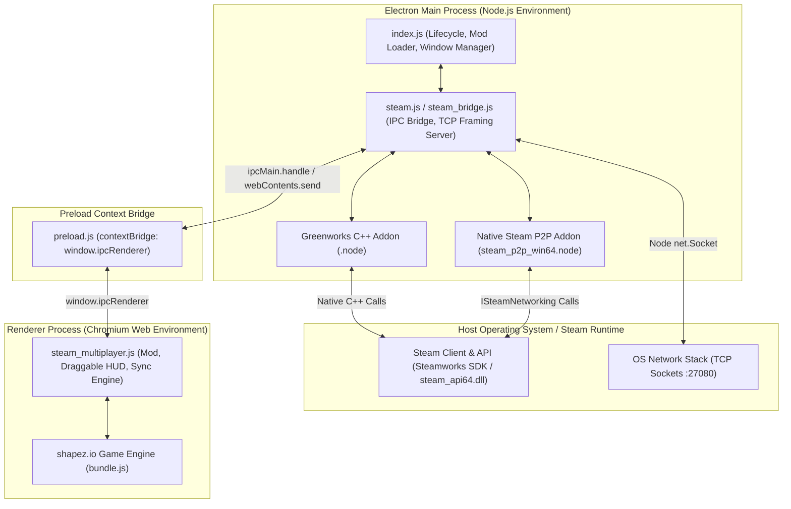

# Technical Design: Architecture & Process Model

## 1. Overview

**shapez.io** is packaged as an Electron desktop application combining a Chromium web runtime with a Node.js desktop environment. In the vanilla release of shapez.io, the game engine operates exclusively in a single-player sandbox, and modding capabilities are separated from Steam networking.

The Co-op Multiplayer Mod implements a hybrid architecture that splits responsibilities across the **Electron Main Process**, the **Electron Preload Context Bridge**, and the **Chromium Renderer Context**.



---

## 2. Process Responsibilities

### 2.1 Electron Main Process (`src/steam_bridge.js` & patched `index.js`)
* **Environment**: Full Node.js runtime with access to native OS libraries, the filesystem, and C++ native Node addons (`.node`).
* **Responsibilities**:
  * **Steamworks Matchmaking & Profile Bridge**: Initializes and interfaces with Greenworks (`shapez.io-private-artifacts/steam/greenworks`). Exposes Steam Lobby management, Steam Friends presence, Steam Overlay triggers, and Rich Presence to the renderer via Electron IPC.
  * **Native Steamworks P2P Engine**: Loads `steam_p2p_win64.node` to bind directly to Valve's `ISteamNetworking` subsystem. Manages Channel 0 (reliable actions/state) and Channel 1 (unreliable high-frequency cursors) with a 15ms drain poll.
  * **TCP Socket Framing Server**: Hosts a `net.Server` socket on port `27080` (with dynamic port auto-increment on conflicts) to allow low-latency direct connections over LAN, VPNs (Tailscale, Hamachi, ZeroTier), or localhost.
  * **Multi-Instance Isolation**: Inspects command-line switches (`--multi-instance`, `--instance-id`) and relocates Electron's `userData` and save game directories so multiple game clients can run concurrently on one machine without database collisions.
  * **Steam Lifecycle Unlocking**: Overrides the vanilla restriction where `steam.listen()` was skipped if any mod was loaded.

### 2.2 Preload Context Bridge (Dynamically Patched `preload.js`)
* **Environment**: Isolated context executing before web scripts load.
* **Responsibilities**:
  * Exposes a secure, limited subset of `ipcRenderer` to `window.ipcRenderer` using Electron's `contextBridge.exposeInMainWorld`.
  * Provides an event listener unsubscription pattern:
    ```javascript
    contextBridge.exposeInMainWorld("ipcRenderer", {
        invoke: ipcRenderer.invoke.bind(ipcRenderer),
        on: (channel, listener) => {
            const wrapped = (event, ...args) => listener(event, ...args);
            ipcRenderer.on(channel, wrapped);
            return () => ipcRenderer.removeListener(channel, wrapped);
        },
        send: ipcRenderer.send.bind(ipcRenderer),
    });
    ```
  * Prevents listener memory leaks when reloading states.

### 2.3 Renderer Process (`src/steam_multiplayer.js`)
* **Environment**: Chromium Web Engine (`shapez.GameRoot`, Canvas UI).
* **Responsibilities**:
  * Extends `shapez.Mod` and injects `HUDMultiplayer extends shapez.BaseHUDPart` (draggable roster, action buttons, smooth scrolling, team chat).
  * Intercepts game mutations via `shapez.ModInterface` (`tryPlaceBuilding`, `tryDeleteBuilding`, `clearBelts`, `tryUnlockUpgrade`, etc.).
  * Dispatches and receives network packets through the IPC bridge (`window.ipcRenderer`).
  * Performs delta action dispatch, chunked initial world transfer reassembly, remote cursor interpolation, ghost building preview overlays, and off-screen directional arrows.

---

## 3. The ASAR Patching Mechanism

Electron bundles application code into an `app.asar` archive located at:
```text
<GameDir>/resources/app.asar
```

### 3.1 Why Binary ASAR Patching is Used
Unpacking the entire `app.asar` archive, modifying files, and repacking with standard tools has critical risks:
1. **Unpacked Native Binaries**: Shapez ships with pre-compiled 64-bit native Steam binaries in `app.asar.unpacked/`. Naive ASAR repacking invalidates the `unpacked: true` metadata flags, preventing Greenworks from loading `greenworks-win64.node`.
2. **Installation Speed**: The entire ASAR is ~60MB+. Rewriting the whole archive takes several seconds, while binary header patching executes in under 50 milliseconds.
3. **Safety & Rollback**: Backing up `app.asar` to `app.asar.vanilla.bak` guarantees 100% reversible, clean uninstallation.

### 3.2 The ASAR Binary Structure
An ASAR archive is an endian-specific Chromium Pickle container with the following header:
```text
+-------------------------+------------------------------------------------+
| Byte Offset             | Purpose                                        |
+-------------------------+------------------------------------------------+
| 0 - 3 (UInt32LE)        | Outer pickle payload size (always 4)           |
| 4 - 7 (UInt32LE)        | Total header byte size (inner pickle + 4)      |
| 8 - 11 (UInt32LE)       | Inner pickle payload size                      |
| 12 - 15 (UInt32LE)      | JSON header string byte length                 |
| 16 - (16 + JSON Length) | UTF-8 encoded JSON file directory tree         |
| Payload Offset          | Concatenated raw file payloads                 |
+-------------------------+------------------------------------------------+
```

### 3.3 Patching Strategy (`scripts/install-mod.js`)
Rather than unpacking files, the installer:
1. Reads the original ASAR buffer and parses the JSON directory table.
2. Appends the updated buffers (`index.js`, `steam.js`, `preload.js`) to the end of the existing payload.
3. Updates the JSON dictionary offsets for each patched file to point to the new positions:
   ```javascript
   headerObj.files[fileName] = {
       size: fileBuffer.length,
       offset: String(currentEndOffset),
       integrity: computeIntegrity(fileBuffer),
   };
   ```
4. Recalculates 4-byte Pickle alignment padding and writes the updated header prefix followed by the original payload and appended patches.
5. Deploys the native P2P module `bin/steam_p2p_win64.node` (generated on demand by `scripts/build-native-p2p.js`) into `<GameDir>/resources/app.asar.unpacked/` so that Electron Main can load `ISteamNetworking` bindings directly.
6. All untouched files (including `bundle.js` and `shapez.io-private-artifacts`) retain their original relative offsets and native unpack pointers.

---

## 4. Steamworks Unlocking & Lifecycle

### 4.1 The Vanilla Mod Restriction
In vanilla `index.js`, the game intentionally disabled Steam whenever mods were detected:
```javascript
// Vanilla index.js (Lines 386-389)
steam.init(isDev);
if (mods.length === 0) {
    steam.listen(); // <-- Never executed when any mod is in %APPDATA%/shapez.io/mods
}
```
As a result, loading any mod caused:
* `ipcMain.handle("steam:*")` handlers were never registered.
* Steam Achievements and DLC verification were disabled.
* In-game Steam overlay invite hooks were ignored.

### 4.2 The Patched Lifecycle
In the dynamically patched `index.js`, `steam.listen()` is called unconditionally:
```javascript
steam.init(isDev, allowMultiInstance);
steam.listen(); // <-- Always executed, keeping Steam active
```

Additionally, `steam.js` detects whether Greenworks successfully initialized:
* **Steam Available**: Initializes Greenworks, binds `steam_p2p_win64.node`, registers Steam lobby listeners, and monitors overlay events.
* **Steam Unavailable (Offline / Dev Fallback)**: Automatically falls back to local virtual profiles (`local_<PID>_<suffix>`), allowing multiplayer testing over direct TCP even when running offline or without the Steam client active.
