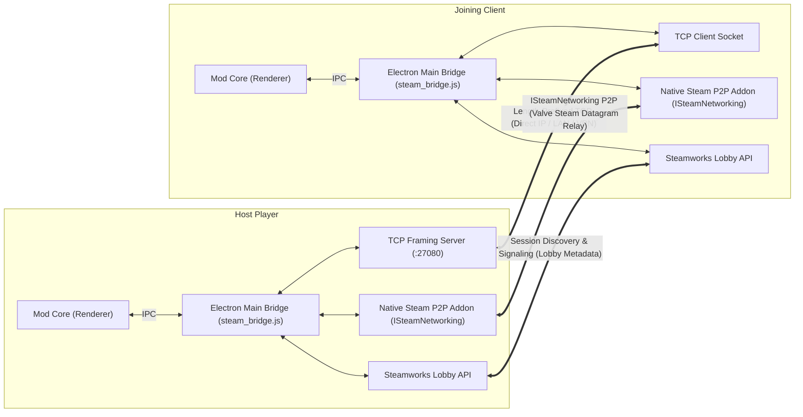

# Technical Design: Networking Protocol & Transports

## 1. Overview

The Co-op Multiplayer Mod features a **dual-transport networking engine** designed to provide instant connections regardless of network environment:

1. **Direct TCP Sockets (Main Process)**: Lowest latency; ideal for LAN, port-forwarded IP addresses, local multi-instance testing (`127.0.0.1:27080`), and virtual private networks (Tailscale, Hamachi, ZeroTier).
2. **Native Steamworks P2P (Main Process)**: High-performance peer-to-peer networking over Valve's Steam Datagram network via the native `ISteamNetworking` API (`steam_p2p_win64.node`). Connects Steam friends across restrictive NATs and firewalls without requiring port-forwarding, third-party relay servers, or friends chat spam.



---

## 2. Transport Layer Details

### 2.1 Direct TCP Framing Layer (`src/steam_bridge.js`)

Node.js TCP sockets (`net.Socket`) transmit arbitrary byte streams rather than discrete message packets. Without framing, multiple JSON packets can be merged into a single `data` event, or a large JSON packet can be fragmented across multiple read buffers.

To guarantee message boundary integrity, all TCP messages use a **4-byte Big-Endian length header**:

```text
+-----------------------+------------------------------------------+
| Header (4 Bytes)      | Payload (N Bytes)                        |
| UInt32BE (N)          | UTF-8 Encoded JSON String                |
+-----------------------+------------------------------------------+
```

#### Serialization (`createFrameBuffer`)
```javascript
function createFrameBuffer(obj) {
    const payload = Buffer.from(JSON.stringify(obj), "utf8");
    const header = Buffer.allocUnsafe(4);
    header.writeUInt32BE(payload.length, 0);
    return Buffer.concat([header, payload]);
}
```

#### Parsing & Reassembly (`attachFrameParser`)
The receiving socket buffers incoming bytes until the expected payload size is fulfilled:
```javascript
function attachFrameParser(socket, onMessage) {
    let buffer = Buffer.alloc(0);
    socket.on("data", chunk => {
        buffer = Buffer.concat([buffer, chunk]);
        while (buffer.length >= 4) {
            const msgLen = buffer.readUInt32BE(0);
            if (buffer.length < 4 + msgLen) {
                break; // Await remaining bytes
            }
            const payload = buffer.subarray(4, 4 + msgLen);
            buffer = buffer.subarray(4 + msgLen);
            try {
                const parsed = JSON.parse(payload.toString("utf8"));
                onMessage(parsed);
            } catch (err) {
                console.warn("Invalid frame payload:", err);
            }
        }
    });
}
```

#### Port Conflict Handling
When hosting, if port `27080` is in use (`EADDRINUSE`), the TCP server automatically increments the port (e.g. `27081`, `27082`) and retries up to 10 times, registering the active endpoint with the Steam Lobby metadata and Rich Presence.

---

### 2.2 Native Steamworks P2P (`ISteamNetworking`) & Lobby Signaling

When connecting via Steam, players are frequently behind carrier-grade NATs (CGNAT) or restrictive corporate/home routers where inbound TCP ports cannot be opened. The mod resolves this using Valve's official **`ISteamNetworking`** API, implemented via a custom PE64 native Node addon (`bin/steam_p2p_win64.node`).

#### Native PE64 Addon Architecture (`scripts/build-native-p2p.js`)
To avoid requiring full Visual Studio C++ toolchains on end-user machines, the native Node addon is synthesized directly as a 64-bit Windows PE DLL with N-API export tables:
* Dynamically resolves `steam_api64.dll` exports inside the running game process (`GetProcAddress`).
* Interfaces directly with `SteamNetworking()` pointer tables:
  * `SendP2PPacket(CSteamID, const void *pubData, uint32 cubData, EP2PSend eP2PSendType, int nChannel)`
  * `ReadP2PPacket(void *pubDest, uint32 cubDest, uint32 *pcubMsgSize, CSteamID *psteamIDRemote, int nChannel)`
  * `AcceptP2PSessionWithUser(CSteamID steamIDRemote)`
  * `CloseP2PSessionWithUser(CSteamID steamIDRemote)`
* Exports JS methods to Electron Main: `init()`, `sendP2PPacket()`, `readP2PPacket()`, `acceptP2PSession()`, `closeP2PSession()`, `requestFriendRichPresence()`, `requestLobbyData()`.

#### Dual Channel Architecture
The native P2P transport allocates two dedicated channels:
* **Channel 0 — Reliable Ordered (`k_EP2PSendReliable = 2`)**: Used for gameplay actions (`ACT_PLACE`, `ACT_DELETE`), world dumps (`WELCOME_WORLD`, `CHUNK_PART`), and hub state sync (`SYNC_HUB`). Retransmits dropped packets automatically and supports payloads up to 1 MB.
* **Channel 1 — Unreliable Low-Latency (`k_EP2PSendUnreliable = 0`)**: Used for remote cursor streaming (`CURSOR`). Dropped packets are ignored in favor of newer updates, avoiding head-of-line blocking.

Incoming packets on both channels are drained every 15ms via an unref'd timer (`drainP2PChannel(0)`, `drainP2PChannel(1)`).

#### Zero Friends Chat Spam
Unlike older implementations that relied on user chat messages (`[SHAPEZ_MP]:...`), the modern engine produces **zero Steam Friends Chat spam**:
* **Session Discovery**: Handled exclusively via official Steam Matchmaking Lobbies (`createSteamLobbyInternal`, `requestLobbyData`) and Steam Rich Presence keys (`shapez_mp_lobby`, `shapez_mp_endpoint`, `shapez_mp_mode`).
* **Session Handshake**: Once a client joins the host's Steam Lobby, peer-to-peer data packets are transmitted directly over Valve's encrypted Steam Datagram Relay.

#### Fallback Metadata Transport (Test & Mock Environments)
If native P2P is unavailable (such as in headless CI environments without `steam_api64.dll`), `steam_bridge.js` includes a windowed, zlib-compressed fallback channel over Steam Lobby Data (`encodeLobbyWindow`, `decodeLobbyWindow`), ensuring connectivity in unit-test harnesses.

---

## 3. Chunked World Transfer Protocol

A shapez.io factory savegame dump can range from 200 KB to over 10 MB depending on factory complexity. Transmitting large monolithic strings in a single message can saturate network buffers.

To ensure smooth delivery without frame drops, `sendChunkedToPeer()` splits the payload into **48 KB slices**:

```javascript
// src/steam_multiplayer.js
sendChunkedToPeer(peer, message) {
    const raw = JSON.stringify(message);
    const CHUNK_SIZE = 49152; // 48 KB
    if (raw.length <= CHUNK_SIZE) {
        this.sendRawToPeer(peer, message);
        return;
    }
    const transferId = "xfer_" + Math.random().toString(36).slice(2, 10);
    const total = Math.ceil(raw.length / CHUNK_SIZE);
    for (let i = 0; i < total; i++) {
        const chunk = raw.slice(i * CHUNK_SIZE, (i + 1) * CHUNK_SIZE);
        this.sendRawToPeer(peer, {
            type: "CHUNK_PART",
            transferId,
            index: i,
            total,
            data: chunk,
        });
    }
}
```

### Client-Side Chunk Reassembly
The client stores received slices inside `clientChunkBuffer`. Once all slices (`received >= total`) arrive:
1. Slices are concatenated in order: `entry.chunks.join("")`.
2. The full payload is deserialized: `JSON.parse(fullJson)`.
3. The message is passed into `onClientReceivedMessage(fullMsg)` as if it were received as a single message.

---

## 4. Packet Schema Reference

All messages dispatched between Host and Clients share a common `type` property:

| Packet `type` | Direction | Description | Key Fields |
| :--- | :--- | :--- | :--- |
| `WELCOME_WORLD` | Host &rarr; Client | Initial factory snapshot on connection | `hostId`, `hostName`, `assignedColor`, `mode`, `roster`, `dump` |
| `CHUNK_PART` | Host &harr; Client | 48 KB fragment of a large packet | `transferId`, `index`, `total`, `data` |
| `ROSTER_UPDATE` | Host &rarr; All | Connected player roster & colors | `players: [{ id, name, color, isHost }]` |
| `CURSOR` | Both directions | Player cursor position & active layer | `senderId`, `name`, `x`, `y`, `layer`, `buildingId`, `variant`, `rotation`, `rotationVariant` |
| `ACT_PLACE` | Both directions | Building, belt, or wire placed | `x`, `y`, `rotation`, `originalRotation`, `rotationVariant`, `variant`, `buildingId` |
| `ACT_DELETE` | Both directions | Building or wire deleted | `x`, `y`, `layer` |
| `ACT_SIGNAL` | Both directions | Constant signal code modified | `x`, `y`, `layer`, `signalCode` |
| `ACT_LEVER` | Both directions | Logic lever toggled | `x`, `y`, `toggled` |
| `ACT_CLEAR_BELTS` | Both directions | Mass selector cleared items from belts | `tiles: [{ x, y, layer }]` |
| `ACT_UPGRADE` | Both directions | Hub tier upgrade unlocked | `upgradeId` |
| `ACT_WAYPOINTS` | Both directions | Map waypoint added, renamed, or deleted | `data: serializedWaypoints` |
| `ACT_PINS` | Both directions | Pinned shape formula modified | `data: serializedPins` |
| `SYNC_HUB` | Host &rarr; Client | Periodic hub shapes and level sync | `level`, `deliveredShapes`, `upgradeLevels` |
| `REQUEST_RESYNC` | Client &rarr; Host | Client requesting fresh world snapshot | `{ type: "REQUEST_RESYNC" }` |
| `CHAT` | Both directions | Chat message sent | `senderName`, `color`, `text` |
| `PING` | Both directions | Animated map ping coordinate | `senderName`, `color`, `x`, `y`, `time` |

---

## 5. Session Codes & Addressing

The mod provides two representations of session connection details:

1. **Standard `IP:Port`**:
   * Example: `127.0.0.1:27080` or `192.168.1.50:27080`.
   * Directly entered in the Join modal or passed via CLI.
2. **Base64 Join Code**:
   * Contains JSON metadata encoding the endpoint, Steam lobby ID, and Host Steam ID:
     ```json
     {
       "e": "192.168.1.50:27080",
       "l": "109775244769012345",
       "h": "76561198000000000"
     }
     ```
   * Generated with `encodeJoinCode()` and decoded via `decodeJoinCode()`.
   * Automatically falls back to raw Steam IDs or IP addresses if entered directly.
