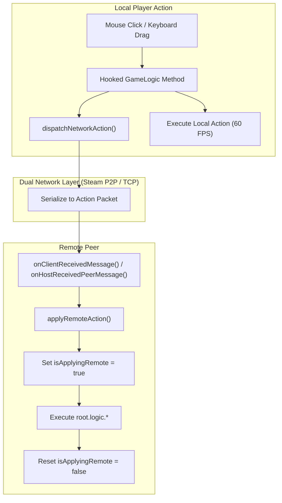
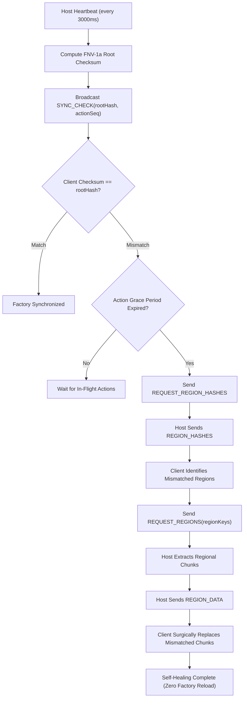

# Technical Design: Synchronization Engine

## 1. Overview & Synchronization Philosophy

**shapez.io** is an entity-component-system (ECS) factory automation game. Hundreds of thousands of items (shapes and color fluids) travel continuously along conveyor belts, underground belts, splitters, balancers, painters, and wires.

### Why Action-Replay Over Position Sync?
Synchronizing the continuous position of every individual shape in real-time would require immense network bandwidth (megabytes per second) and cause visual stuttering. 

Instead, the mod adopts an **Action-Replay Architecture**:
* **Deterministic Local Simulation**: Each player's local game engine simulates conveyor belt movements, item splitting, cutting, and coloring at a full 60 ticks per second.
* **Shared Entity Topography**: The mod guarantees that the underlying map topography (buildings, belt networks, wire components, signals) is identical across all peers.
* **Result**: Players experience silky-smooth, zero-jitter 60 FPS factory operation with minimal network bandwidth usage (~1-5 KB/s during active building).



---

## 2. Game Engine Interception (`src/multiplayer/sync/game_hooks.js`)

The mod hooks into core game subsystems during initialization (`setupGameHooks()`) using the official `shapez.ModInterface` extension API.

### 2.1 Building & Belt Placement (`shapez.GameLogic.tryPlaceBuilding`)
When a player clicks to place a single building or drags a belt/wire line:
```javascript
this.modInterface.replaceMethod(shapez.GameLogic, "tryPlaceBuilding", function (original, [args]) {
    const wasInside = self.isInsidePlaceBuilding;
    self.isInsidePlaceBuilding = true;
    let entity = null;
    try {
        entity = original(args);
    } finally {
        self.isInsidePlaceBuilding = wasInside;
    }

    if (entity && !self.isApplyingRemote && self.isSessionActive()) {
        const { origin, rotation, rotationVariant, originalRotation, variant, building } = args;
        self.dispatchNetworkAction({
            type: "ACT_PLACE",
            x: origin.x,
            y: origin.y,
            rotation,
            originalRotation,
            rotationVariant,
            variant,
            buildingId: building.getId(),
        });
    }
    return entity;
});
```

### 2.2 Building & Wire Deletion (`shapez.GameLogic.tryDeleteBuilding`)
Intercepts individual clicks, mass-deletions, or belt removals:
```javascript
this.modInterface.replaceMethod(shapez.GameLogic, "tryDeleteBuilding", function (original, [entity]) {
    let tileX = null, tileY = null, layer = "regular";
    if (entity && entity.components && entity.components.StaticMapEntity) {
        tileX = entity.components.StaticMapEntity.origin.x;
        tileY = entity.components.StaticMapEntity.origin.y;
        layer = entity.layer || "regular";
    }

    const deleted = original(entity);
    if (deleted && tileX !== null && !self.isApplyingRemote && !self.isInsidePlaceBuilding && self.isSessionActive()) {
        self.dispatchNetworkAction({
            type: "ACT_DELETE",
            x: tileX,
            y: tileY,
            layer,
        });
    }
    return deleted;
});
```


### 2.4 Blueprint Placement Synchronization (`shapez.Blueprint.tryPlace` & `ACT_BLUEPRINT`)
In vanilla shapez.io, blueprint pasting does **not** call `GameLogic.tryPlaceBuilding`. Instead, `Blueprint.prototype.tryPlace` directly clones blueprint entities, deletes replaceable buildings via `freeEntityAreaBeforeBuild`, and registers new entities directly into the spatial map (`map.placeStaticEntity`) and entity manager (`entityMgr.registerEntity`) inside a bulk operation wrapper (`performBulkOperation` + `performImmutableOperation`).

To achieve real-time synchronization without requiring full savegame resynchronization:
1. **Hook & Entity Capture**: `setupGameHooks()` intercepts `shapez.Blueprint.prototype.tryPlace`. It sets `isInsidePlaceBuilding = true` to prevent `freeEntityAreaBeforeBuild` from triggering false `ACT_DELETE` packets when placing over existing replaceable structures.
2. **Atomic Registration Tracking**: During `tryPlace`, the hook temporarily intercepts `root.entityMgr.registerEntity` to capture the exact list of entities successfully placed.
3. **Payload Dispatch**: Serializes placed coordinates, meta-building IDs, rotation parameters, variants, layer (`regular` vs `wires`), constant signal keys (`ConstantSignal`), and lever toggles (`Lever`), broadcasting as `ACT_BLUEPRINT`.
4. **Remote Execution**: Peers replicate the batch within `performBulkOperation` and `performImmutableOperation`, triggering native belt connection recalculations and wire network graph rebuilds with zero frame drops.
5. **Host-Authoritative Shape Deduction**: If copy/paste is not free, the Host deducts the blueprint shape cost from `hubGoals.storedShapes` and broadcasts the updated total via `SYNC_HUB`.

### 2.3 Logic Gate & Wire Synchronization
The mod synchronizes the advanced Wires DLC components:
* **Constant Signals (`shapez.HUDConstantSignalEdit`)**: When a player configures a constant signal (value, shape, boolean, or color), the updated signal code is extracted via `signal.getAsCopyableKey()` and broadcast as `ACT_SIGNAL`.
* **Logic Levers (`shapez.HUDLeverToggle`)**: Left-click toggle events on lever entities are intercepted and broadcast as `ACT_LEVER`.
* **Mass Belt Clearing (`shapez.HUDMassSelector`)**: When players highlight an area and select "Clear Items on Belts", tile coordinates are collected and broadcast as `ACT_CLEAR_BELTS`.

---

## 3. Recursion & Infinite Echo Prevention

### The Problem
When Player A places a belt:
1. `tryPlaceBuilding` intercepts the placement and broadcasts `ACT_PLACE` to Player B.
2. Player B receives `ACT_PLACE` and invokes `root.logic.tryPlaceBuilding` to replicate the belt locally.
3. **Without protection**, Player B's interceptor would trigger again and broadcast `ACT_PLACE` back to Player A, creating an infinite broadcast storm.

### The Solution: Reentrancy Guards
1. **`isApplyingRemote`**:
   * Wrapped around all execution inside `applyRemoteAction()`:
     ```javascript
     this.isApplyingRemote = true;
     try {
         // Apply remote action in local world
     } finally {
         this.isApplyingRemote = false;
     }
     ```
   * Interceptors check `if (!this.isApplyingRemote)` before broadcasting any network packet.
2. **`isInsidePlaceBuilding`**:
   * In shapez.io, placing a building over an existing building automatically deletes the previous building first.
   * The `isInsidePlaceBuilding` flag prevents the intermediate deletion from generating a spurious `ACT_DELETE` packet during single building placement and blueprint pastes.

---

## 4. World State Bootstrap & Resync

### 4.1 Initial World Loading & Savegame Isolation (`loadHostWorldDump`)
When a client joins an existing session or initiates a resync:
1. The Host serializes the entire current simulation state:
   ```javascript
   const serializer = new shapez.SavegameSerializer();
   const dump = serializer.generateDumpFromGameRoot(this.currentRoot, false);
   ```
2. The Host sends the serialized dump (chunked in 48 KB packets) via `WELCOME_WORLD`, stamped with `actionSeq` and `hubSeq`.
3. **Savegame Isolation Guarantee**: To prevent overwriting the player's personal singleplayer factory if they joined while already in-game, the mod never mutates `this.currentRoot.savegame`. Instead, it allocates a dedicated new savegame instance (`this.app.savegameMgr.createNewSavegame()`) and tracks it as `this.activeCoopSavegame`:
   ```javascript
   let savegame = this.activeCoopSavegame;
   if (!savegame) {
       savegame = this.app.savegameMgr.createNewSavegame();
       this.activeCoopSavegame = savegame;
   }
   savegame.currentData = {
       version: savegame.getCurrentVersion(),
       dump: worldDump,
       stats: { failedMam: false, trashedCount: 0, usedInverseRotater: false },
       lastUpdate: Date.now(),
       mods: shapez.MODS.getModsListForSavegame(),
   };
   savegame.metaDataRef.name = "Co-op (" + safeHost + ")";
   ```
4. **Seamless In-Game Reloading**: In shapez.io, calling `app.stateMgr.moveToState("InGameState")` while already inside `InGameState` is rejected with an error by the game's state machine. To enable live resync without forcing the player to leave and rejoin:
   - If the player is currently in `InGameState`, the mod sets `this.isReloadingWorld = true` and `this.pendingWorldEntry = () => this.app.stateMgr.moveToState("InGameState", { savegame, fastEnter: true })`.
   - It transitions temporarily through `MainMenuState`: `this.app.stateMgr.moveToState("MainMenuState")`.
   - The mod listens on `stateEntered`; when `MainMenuState` finishes entering, it intercepts the transition, executes `pendingWorldEntry()`, and cleanly transitions back into `InGameState` with the fresh snapshot.
   - The `isReloadingWorld` flag ensures the client does not close its network socket or trigger disconnection cleanup during this transient cycle.

### 4.2 On-Demand Resynchronization (`REQUEST_RESYNC`)
If a client experiences network packet loss or needs to refresh their local state:
1. The client clicks the **Resync** button on the Multiplayer HUD.
2. The client transmits `{ type: "REQUEST_RESYNC" }` to the Host.
3. The Host generates a fresh world dump snapshot and transmits a new chunked `WELCOME_WORLD` packet.
4. The client replaces their local map state seamlessly via the reload cycle.

---

## 5. Hub Goals & Upgrade Synchronization

### 5.1 Host-Authoritative Progression & Multiplier Invariants
In vanilla shapez.io, upgrading a tier (belts, miners, processors, painters) mutates two distinct data structures in `shapez.HubGoals`:
1. `upgradeLevels[upgradeId]`: An integer tier count (e.g., Tier II = 1, Tier III = 2, Tier IV = 3).
2. `upgradeImprovements[upgradeId]`: A floating-point speed multiplier (e.g., 1.5x, 2.0x, 2.5x).

Changing `upgradeLevels` alone without recomputing `upgradeImprovements` causes severe UI and simulation desyncs (e.g. tooltips displaying `Tier IV: x1.50 -> x2.50` where speed multipliers remain stuck at lower tiers). 

To ensure exact synchronization:
* **Host Authority**: Only the Host determines whether upgrade requirements (stored shapes) are met and authoritatively advances the research tree.
* **Exact Multiplier Recomputation (`recomputeUpgradeImprovements`)**: Whenever the client or host applies an upgrade snapshot, `recomputeUpgradeImprovements()` calculates exact geometric progression multipliers matching vanilla `shapez.HubGoals.deserialize`:
  ```javascript
  const count = hubGoals.upgradeLevels[upgradeId] || 0;
  let factor = 1.0;
  for (let i = 0; i < count; ++i) {
      factor *= shapez.tierImprovementPatterns[upgradeId](i);
  }
  hubGoals.upgradeImprovements[upgradeId] = factor;
  ```
* **Exact State Overwrite**: Hub state synchronization (`applyHubSync`) performs an authoritative, exact overwrite of both stored shapes and upgrade tiers—never using one-way `Math.max()` clamps—allowing corrections in either direction.

### 5.2 Client Optimistic Prediction & Reconciliation
When a client clicks an upgrade in their local Hub:
1. **Local Prediction**: `hubSync.predictUpgrade(upgradeId)` immediately increments the client's local level and updates `upgradeImprovements`, providing zero-latency visual responsiveness without button lag or flicker.
2. **Authoritative Request**: The client dispatches `{ type: "REQUEST_UPGRADE", upgradeId }` to the Host.
3. **Host Validation**: The Host checks `root.hubGoals.tryUnlockUpgrade(upgradeId)`. If valid, the Host purchases the upgrade, advances story goals, and broadcasts `SYNC_HUB` with an incremented sequence number `seq` and `ackReq: upgradeId`.
4. **Reconciliation**: When the client receives `SYNC_HUB`, it acknowledges and removes the pending prediction. If the Host rejects the request or an unconfirmed prediction exceeds `PREDICTION_TIMEOUT_MS` (3000ms), the client rolls back to the Host's authoritative level seamlessly.

---

## 6. Background World Checksum & Spatial Region Self-Healing

Even with deterministic action dispatch, background floating point rounding, late joins, or transient dropped frames could theoretically introduce subtle tile discrepancies. To guarantee factory synchronization without user intervention:



### 6.1 Spatial Region Bucketing
* The infinite world grid is partitioned into **16x16 chunk spatial regions** (each region spanning 256x256 tiles).
* Region coordinates are indexed via `getRegionKey(chunkX, chunkY)`.
* Only populated chunks containing static buildings or belts are hashed, minimizing computational overhead.

### 6.2 Deterministic FNV-1a Region Hashing
For each region, `computeRegionHashes()` iterates over constituent chunks in sorted spatial order, feeding building origins, IDs, layers, variants, and rotations into a 32-bit FNV-1a hashing function. A root hash is derived by XOR-folding all individual region hashes.

### 6.3 Progressive Drift Detection & Surgical Self-Healing
1. **Lightweight Checksum Heartbeat (`SYNC_CHECK`)**: Every 3000ms, the Host broadcasts `{ type: "SYNC_CHECK", rootHash, actionSeq }`.
2. **In-Flight Action Grace Period**: If the client's local root hash does not match, the mod checks whether actions are currently in flight (`lastAppliedActionSeq < actionSeq`). Discrepancies within a 6000ms grace window are ignored to avoid false alarms while players are actively placing buildings.
3. **Escalation & Region Query (`REQUEST_REGION_HASHES`)**: If a discrepancy persists beyond the grace period over consecutive checks, the client queries the Host for regional hashes via `{ type: "REQUEST_REGION_HASHES" }`.
4. **Targeted Region Repair (`REQUEST_REGIONS` / `REGION_DATA`)**: The client compares region hashes, isolates only the differing region keys (typically just 1 or 2 regions), and requests their chunk data via `{ type: "REQUEST_REGIONS", keys }`.
5. **Non-Disruptive Patching (`applyRegionData`)**: The Host extracts the exact entities in those regions via `serializeRegions()` (resolving `getMetaBuilding()`, `getRotationVariant()`, and `getVariant()` on `StaticMapEntityComponent`) and transmits `REGION_DATA`. The client wraps the repair in `performBulkOperation` and `isInsidePlaceBuilding = true`, removes only existing entities whose origin anchors inside the target 16x16 region (preserving multi-tile buildings anchored in adjacent regions), and reconstructs the authoritative entities—healing any drift without reloading the factory.
