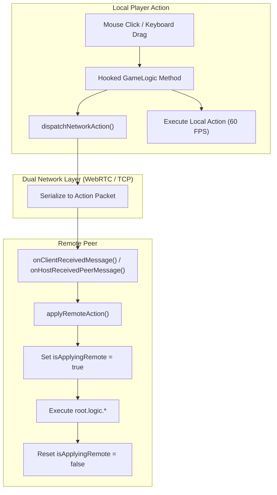

# Technical Design: Synchronization Engine

## 1. Overview & Synchronization Philosophy

**shapez.io** is an entity-component-system (ECS) factory automation game. Hundreds of thousands of items (shapes and color fluids) travel continuously along conveyor belts, underground belts, splitters, balancers, painters, and wires.

### Why Action-Replay Over Position Sync?
Synchronizing the continuous position of every individual shape in real-time would require immense network bandwidth (megabytes per second) and cause visual stuttering. 

Instead, the mod adopts an **Action-Replay Architecture**:
* **Deterministic Local Simulation**: Each player's local game engine simulates conveyor belt movements, item splitting, cutting, and coloring at a full 60 ticks per second.
* **Shared Entity Topography**: The mod guarantees that the underlying map topography (buildings, belt networks, wire components, signals) is identical across all peers.
* **Result**: Players experience silky-smooth, zero-jitter 60 FPS factory operation with minimal network bandwidth usage (~1-5 KB/s during active building).



---

## 2. Game Engine Interception (`src/steam_multiplayer.js`)

The mod hooks into core game subsystems during initialization (`setupGameHooks()`) using the official `shapez.ModInterface` extension API.

### 2.1 Building & Belt Placement (`shapez.GameLogic.tryPlaceBuilding`)
When a player clicks to place a single building, drags a belt/wire line, or pastes a blueprint:
```javascript
this.modInterface.replaceMethod(shapez.GameLogic, "tryPlaceBuilding", function (original, [args]) {
    const wasInside = self.isInsidePlaceBuilding;
    self.isInsidePlaceBuilding = true;
    let entity = null;
    try {
        entity = original(args);
    } finally {
        self.isInsidePlaceBuilding = wasInside;
    }

    if (entity && !self.isApplyingRemote && self.isSessionActive()) {
        const { origin, rotation, rotationVariant, originalRotation, variant, building } = args;
        self.dispatchNetworkAction({
            type: "ACT_PLACE",
            x: origin.x,
            y: origin.y,
            rotation,
            originalRotation,
            rotationVariant,
            variant,
            buildingId: building.getId(),
        });
    }
    return entity;
});
```

### 2.2 Building & Wire Deletion (`shapez.GameLogic.tryDeleteBuilding`)
Intercepts individual clicks, mass-deletions, or belt removals:
```javascript
this.modInterface.replaceMethod(shapez.GameLogic, "tryDeleteBuilding", function (original, [entity]) {
    let tileX = null, tileY = null, layer = "regular";
    if (entity && entity.components && entity.components.StaticMapEntity) {
        tileX = entity.components.StaticMapEntity.origin.x;
        tileY = entity.components.StaticMapEntity.origin.y;
        layer = entity.layer || "regular";
    }

    const deleted = original(entity);
    if (deleted && tileX !== null && !self.isApplyingRemote && !self.isInsidePlaceBuilding && self.isSessionActive()) {
        self.dispatchNetworkAction({
            type: "ACT_DELETE",
            x: tileX,
            y: tileY,
            layer,
        });
    }
    return deleted;
});
```

### 2.3 Logic Gate & Wire Synchronization
The mod synchronizes the advanced Wires DLC components:
* **Constant Signals (`shapez.HUDConstantSignalEdit`)**: When a player configures a constant signal (value, shape, boolean, or color), the updated signal code is extracted via `signal.getAsCopyableKey()` and broadcast as `ACT_SIGNAL`.
* **Logic Levers (`shapez.HUDLeverToggle`)**: Left-click toggle events on lever entities are intercepted and broadcast as `ACT_LEVER`.
* **Mass Belt Clearing (`shapez.HUDMassSelector`)**: When players highlight an area and select "Clear Items on Belts", tile coordinates are collected and broadcast as `ACT_CLEAR_BELTS`.

---

## 3. Recursion & Infinite Echo Prevention

### The Problem
When Player A places a belt:
1. `tryPlaceBuilding` intercepts the placement and broadcasts `ACT_PLACE` to Player B.
2. Player B receives `ACT_PLACE` and invokes `root.logic.tryPlaceBuilding` to replicate the belt locally.
3. **Without protection**, Player B's interceptor would trigger again and broadcast `ACT_PLACE` back to Player A, creating an infinite broadcast storm.

### The Solution: Reentrancy Guards
1. **`isApplyingRemote`**:
   * Wrapped around all execution inside `applyRemoteAction()`:
     ```javascript
     this.isApplyingRemote = true;
     try {
         // Apply remote action in local world
     } finally {
         this.isApplyingRemote = false;
     }
     ```
   * Interceptors check `if (!this.isApplyingRemote)` before broadcasting any network packet.
2. **`isInsidePlaceBuilding`**:
   * In shapez.io, placing a building over an existing building automatically deletes the previous building first.
   * The `isInsidePlaceBuilding` flag prevents the intermediate deletion from generating a spurious `ACT_DELETE` packet.

---

## 4. World State Bootstrap & Resync

### 4.1 Initial World Loading & Savegame Isolation (`loadHostWorldDump`)
When a client joins an existing session:
1. The Host serializes the entire current simulation state:
   ```javascript
   const serializer = new shapez.SavegameSerializer();
   const dump = serializer.generateDumpFromGameRoot(this.currentRoot, false);
   ```
2. The Host sends the serialized dump (chunked in 48 KB packets) via `WELCOME_WORLD`.
3. **Savegame Isolation Guarantee**: To prevent overwriting the player's personal singleplayer factory if they joined while already in-game, the mod never mutates `this.currentRoot.savegame`. Instead, it allocates a dedicated new savegame instance (`this.app.savegameMgr.createNewSavegame()`) and tracks it as `this.activeCoopSavegame`:
   ```javascript
   let savegame = this.activeCoopSavegame;
   if (!savegame) {
       savegame = this.app.savegameMgr.createNewSavegame();
       this.activeCoopSavegame = savegame;
   }
   savegame.currentData = {
       version: savegame.getCurrentVersion(),
       dump: worldDump,
       stats: { failedMam: false, trashedCount: 0, usedInverseRotater: false },
       lastUpdate: Date.now(),
       mods: shapez.MODS.getModsListForSavegame(),
   };
   savegame.metaDataRef.name = "Co-op (" + safeHost + ")";
   this.app.stateMgr.moveToState("InGameState", { savegame, fastEnter: true });
   ```
4. On subsequent on-demand resyncs (`REQUEST_RESYNC`), the mod reuses `this.activeCoopSavegame` rather than spawning duplicate save slots.

### 4.2 On-Demand Resynchronization (`REQUEST_RESYNC`)
If a client experiences network packet loss or joins late during a massive blueprint paste:
1. The client clicks the **Resync** button on the Multiplayer HUD.
2. The client transmits `{ type: "REQUEST_RESYNC" }` to the Host.
3. The Host generates a fresh world dump snapshot and transmits a new `WELCOME_WORLD` packet.
4. The client replaces their local map state instantly.

---

## 5. Hub Goals & Upgrade Synchronization

### 5.1 Shared Research Tiers (`ACT_UPGRADE`)
When any player purchases a speed upgrade or tool tier in the Hub:
```javascript
// Local buy intercepted
self.dispatchNetworkAction({
    type: "ACT_UPGRADE",
    upgradeId,
});

// Remote apply with desync protection
case "ACT_UPGRADE": {
    if (root.hubGoals && msg.upgradeId) {
        if (!root.hubGoals.tryUnlockUpgrade(msg.upgradeId)) {
            // Force apply if client's stored shape delivery was slightly behind host
            const currentLv = root.hubGoals.getUpgradeLevel(msg.upgradeId);
            root.hubGoals.upgradeLevels[msg.upgradeId] = currentLv + 1;
            root.signals.upgradePurchased.dispatch(msg.upgradeId);
        }
    }
    break;
}
```

### 5.2 Periodic Hub Heartbeat (`SYNC_HUB`)
Every 2000ms, the Host broadcasts an authoritative state packet containing:
* Current factory level and target shape.
* Shape delivery throughput counts.
* Upgrade level dictionary.

This guarantees that even if a single delivery signal was lost during high-speed belt throughput, all players remain on identical levels and progression states.
